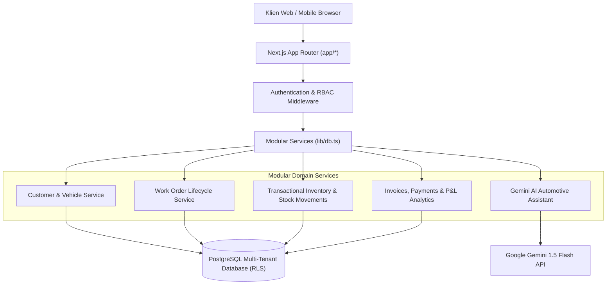

# BengkelPro — System Architecture & Technical Design

## 1. High-Level Architectural Pattern
BengkelPro mengadopsi pola **Modular Monolith** dengan Next.js App Router (React Server & Client Components) dan Supabase Managed PostgreSQL.

Arsitektur ini memberikan:
- Latensi ultra-rendah antar modul bisnis (Pelanggan, SPK, Stok, Faktur, Keuangan).
- Kemudahan deployment di Railway / VPS dengan container standalone.
- Isolasi multi-tenant kuat melalui PostgreSQL Row Level Security (RLS).

---

## 2. Layered Architecture Diagram

---

## 3. Technology Stack Breakdown

| Komponen | Pilihan Teknologi | Versi | Alasan Pemilihan |
| :--- | :--- | :--- | :--- |
| **Frontend Framework** | Next.js (App Router) | 14.2.35 | Server Components, SEO optimal, performa tinggi |
| **Bahasa Pemrograman** | TypeScript (Strict Mode) | 5.6.3 | Type-safety penuh, meminimalisir bug runtime |
| **Styling & Design System** | Tailwind CSS | 3.4.14 | Fleksibilitas tinggi, styling responsif mobile-first |
| **Ikon Antarmuka** | Lucide React | 0.453.0 | Desain modern, ringan, dan konsisten |
| **Validasi Skema** | Zod | 3.23.8 | Validasi data form dan endpoint API terintegrasi |
| **Automated Testing** | Vitest | 2.1.9 | Eksekusi pengujian unit & integrasi instan |
| **Database Engine** | Supabase PostgreSQL | 15+ | Relasi ACID, Row Level Security, pg_stat |
| **AI Assistant** | Google Gemini API | 1.5 Flash | Analisis keluhan teknis dalam Bahasa Indonesia |
| **Hosting Aplikasi** | Railway Production | Node.js | Continuous Deployment, port binding, auto-restart |
