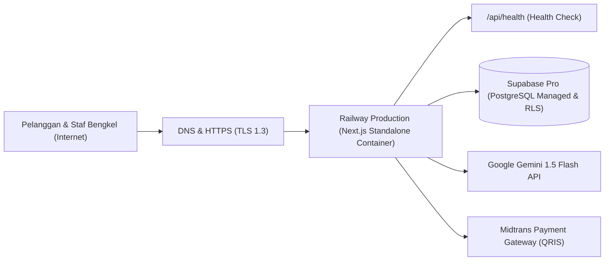

# BengkelPro — Production Deployment & DevOps Guide

Dokumen ini menjelaskan prosedur deployment produksi BengkelPro ke **Railway Production** dan **Supabase Pro**.

---

## 1. Production Architecture Overview

---

## 2. Railway Deployment Configuration
BengkelPro menggunakan mode standalone container Next.js yang sangat efisien dalam penggunaan memori dan CPU.

### A. Parameter Konfigurasi Railway:
- **Build Command**: `npm run build`
- **Start Command**: `npm start` (atau `node .next/standalone/server.js`)
- **Healthcheck Path**: `/api/health`
- **Healthcheck Timeout**: 30 detik
- **Restart Policy**: `ALWAYS` (Restart otomatis jika container berhenti)
- **Port Binding**: Menggunakan variabel `$PORT` yang disediakan oleh Railway secara dinamis (default: 3000).

---

## 3. Supabase Pro Database Configuration
1. Buat project baru di [Supabase Dashboard](https://supabase.com).
2. Buka tab **SQL Editor**.
3. Eksekusi script migrasi dari repository: `migrations/001_initial_schema.sql`.
4. Script ini otomatis:
   - Mengaktifkan ekstensi `uuid-ossp`.
   - Membuat 34 tabel relasional ternormalisasi dengan constraint unik dan indeks.
   - Mengaktifkan **Row Level Security (RLS)** pada seluruh tabel tenant.
   - Mendaftarkan fungsi otorisasi multi-tenant `is_workshop_member(workshop_id)`.
5. Salin `Project URL`, `Anon Key`, dan `Service Role Key` ke Railway Environment Variables.

---

## 4. Continuous Health & Uptime Monitoring
Endpoint pemantauan produksi:
- `GET https://[domain-produksi]/api/health`
- Endpoint ini merespons HTTP `200 OK` saat server dan koneksi database dalam keadaan sehat, tanpa mengekspos rahasia sistem atau connection string.
- Sambungkan URL ini ke UptimeRobot / BetterStack untuk notifikasi instan via WhatsApp / Email saat terjadi downtime jaringan.
